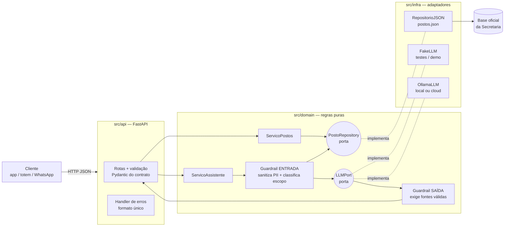
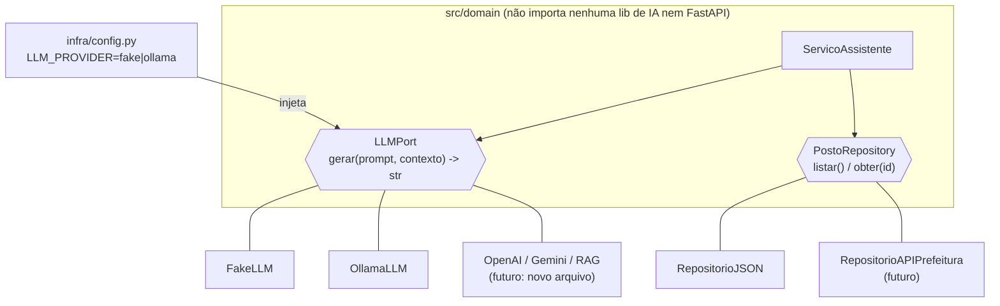

# 3. Arquitetura — Posto Certo

**GS2026.2 · Frente D · Turma 2CCPY-2026**
Lucas Andrade Souza (RM 564066) · Luis Otavio Santini Feitosa (RM 563556)

> **Pergunta-guia:** "Se eu tirar o LLM desse sistema e colocar outro, o que quebra?"
> **Resposta:** nada no domínio. Muda uma variável de ambiente (`LLM_PROVIDER`) e, no máximo, entra um novo arquivo de adaptador em `src/infra/llm/`.

---

## 3.1 Diagrama de componentes e fluxo

O fluxo segue a ordem **fonte de dados → adaptador → serviço → LLM → guardrail → resposta**:



**Passo a passo do `POST /ask`:**
1. A API valida o corpo contra o contrato. Se falhar, devolve 422.
2. **Guardrail de entrada:** mascara CPF e telefone, depois classifica a pergunta.
   - Emergência → resposta fixa com o **192**, sem chamar o LLM (RF-05).
   - Pergunta clínica → recusa `FORA_DO_ESCOPO`, sem chamar o LLM (RF-04).
3. O serviço busca os postos relevantes pela porta `PostoRepository` e monta o contexto.
4. O serviço chama `LLMPort.gerar(prompt, contexto)`. Timeout ou erro viram `IAIndisponivel` → **503** (RF-07).
5. **Guardrail de saída:** a resposta precisa citar ao menos um id que esteja no contexto. Se não citar, vira recusa `SEM_DADOS`, o que bloqueia alucinação.
6. A API devolve o schema `Resposta` do contrato.

> Os passos 2 e 5 são **código determinístico** e não dependem do modelo. Por isso, a segurança não piora quando o LLM é trocado.

## 3.2 Fronteiras — portas e adaptadores



**Estrutura de pastas do slice:**

```
4_slice/src/
├── domain/        # modelos, portas (Protocol), serviços, guardrails, exceções
├── infra/         # repositorio_json.py, llm/fake.py, llm/ollama.py, config.py
└── api/           # main.py (rotas FastAPI), schemas.py, erros.py
```

**Regra de dependência:** `api → domain ← infra`. O domínio não conhece ninguém, e o CI verifica isso com um teste que garante que `src/domain` não importa `fastapi`, `httpx`, `ollama`, `langchain` nem `openai`.

**Trocar o modelo em 1 linha de configuração:**

```bash
LLM_PROVIDER=ollama   # antes: fake
OLLAMA_MODEL=llama3.2 # trocar de modelo dentro do mesmo provedor
```

## 3.3 Ponto de extensão da IA

Uma nova capacidade de IA entra **sempre como um novo adaptador de `LLMPort`**, registrado na fábrica de `infra/config.py`:

| Nova capacidade | O que muda | O que NÃO muda |
|---|---|---|
| Outro modelo (ex.: GPT, Gemini) | Novo `infra/llm/openai.py` + 1 linha na fábrica | Domínio, guardrails, API, contrato |
| RAG com busca vetorial | Novo adaptador `PostoRepository` com busca semântica | `ServicoAssistente`, guardrails |
| Agente com ferramentas | Adaptador que implementa `LLMPort` internamente | Contrato `POST /ask` |

O critério de entrada é que todo novo adaptador passe pelo **mesmo conjunto de evals** (ver `5_evals_de_ia.md`) antes de ser ativado.

## 3.4 ADRs (Architecture Decision Records)

### ADR-01 — Chamada direta via porta própria × LangChain
- **Contexto:** precisamos chamar um LLM, mas o domínio não pode depender do fornecedor. O escopo é pequeno: um prompt e um contexto.
- **Opções:**
  1. **LangChain:** abstrai provedores e tem ecossistema grande.
  2. **Porta própria (`LLMPort`) + chamada HTTP direta:** uma interface de 1 método.
- **Decisão:** opção 2, porta própria.
- **Consequências:**
  - ✅ Zero dependência pesada e testes simples, porque o fake é uma classe de 5 linhas. O domínio fica limpo.
  - ❌ Recursos prontos (memória, agentes, retries) precisam ser escritos à mão se forem necessários.
  - 🔁 **Reversível:** LangChain pode entrar depois *como mais um adaptador* atrás da mesma porta, sem tocar no domínio.

### ADR-02 — Contexto filtrado no prompt × RAG vetorial
- **Contexto:** a IA precisa responder só com dados oficiais. A base tem dezenas de postos, não milhares.
- **Opções:**
  1. **RAG com embeddings + banco vetorial.**
  2. **Filtro determinístico** (por serviço e bairro) com os postos encontrados injetados no prompt como JSON.
- **Decisão:** opção 2, filtro determinístico.
- **Consequências:**
  - ✅ É previsível e auditável: sabemos exatamente quais postos o modelo viu, e isso viabiliza o guardrail de `fontes`. Não há infraestrutura extra.
  - ❌ Não escala para bases grandes e perde perguntas com sinônimos ("dentista" × `ODONTOLOGIA`), o que é mitigado com um dicionário de sinônimos.
  - 🔁 **Gatilho para revisar:** base com mais de 500 postos, ou taxa `SEM_DADOS` acima de 15 % nos evals.

### ADR-03 — Ollama (modelo aberto) × API externa paga
- **Contexto:** o serviço é de uma prefeitura, então custo e dados do cidadão (LGPD) importam.
- **Opções:**
  1. **API externa** (OpenAI ou Gemini): melhor qualidade, mas custo por token e dados saindo da infraestrutura.
  2. **Ollama** (local ou on-premise): custo zero por chamada e dados dentro da prefeitura.
- **Decisão:** **Ollama** como provedor padrão, com **FakeLLM** em testes e CI.
- **Consequências:**
  - ✅ Custo previsível, sem chave de API para vazar, e alinhado à LGPD.
  - ❌ Modelos menores tendem a ter qualidade inferior e exigem hardware com GPU para latência baixa (risco ao RNF-02).
  - 🔁 Como a troca é só configuração, uma API externa pode ser testada nos evals sem mudar o código.

## 3.5 Observabilidade

Cada requisição gera um **log estruturado em JSON** com `trace_id`, que também volta na resposta para facilitar o suporte. **Nenhum dado pessoal vai para o log**: a pergunta é registrada já sanitizada (RNF-06).

| Métrica | Origem | Por quê |
|---|---|---|
| `http_request_duration_seconds` (p95 por rota) | Middleware da API | RNF-01 e RNF-02 |
| `http_errors_total` por status | Handler de erros | Saúde do serviço |
| `llm_latency_ms` | Adaptador LLM | Isola a lentidão do modelo da lentidão do serviço |
| `llm_falhas_total` (timeout / erro) | Adaptador LLM | Origem dos 503 |
| `assistente_recusas_total` por `motivo` | Guardrails | Monitora a qualidade da IA |
| `llm_tokens_total` (entrada e saída) | Adaptador LLM | Custo e capacidade |
| `base_idade_horas` | Repositório | Dados desatualizados |

**Alertas:**

| Alerta | Condição | Ação |
|---|---|---|
| 🔴 IA fora | `503` > 5 % das chamadas a `/ask` em 5 min | Acionar plantão; o `/postos` continua no ar |
| 🟠 IA lenta | p95 de `/ask` > 4 s por 10 min | Verificar o host do Ollama ou trocar de modelo |
| 🟠 Alucinação bloqueada | `SEM_DADOS` > 15 % em 1 h | Rodar a suíte de evals e revisar prompt ou modelo |
| 🟡 Recusa anômala | `FORA_DO_ESCOPO` > 30 % em 1 dia | Revisar o classificador, que pode estar bloqueando perguntas válidas |
| 🟡 Base velha | `base_idade_horas` > 24 | Avisar a Secretaria |

## 3.6 Segurança

| Ponto | Onde | Como |
|---|---|---|
| Validação de entrada | `src/api` | Schemas Pydantic espelhando o contrato: `pattern` do id, `maxLength` 500 na pergunta e `additionalProperties: false` |
| Sanitização de PII | `src/domain/guardrails.py` | Regex que mascara CPF, telefone e cartão SUS **antes** do LLM e do log |
| Prompt injection | `src/domain` | Pergunta delimitada no prompt como dado do usuário, mais o guardrail de saída que ignora respostas sem fonte válida |
| Segredos | `src/infra/config.py` | Lidos só de variável de ambiente; `.env` no `.gitignore`; `.env.example` sem valores reais; varredura no CI (RNF-05) |
| Falha segura | Adaptador LLM | Timeout de 8 s; em qualquer erro do modelo devolve 503, nunca uma resposta parcial |
