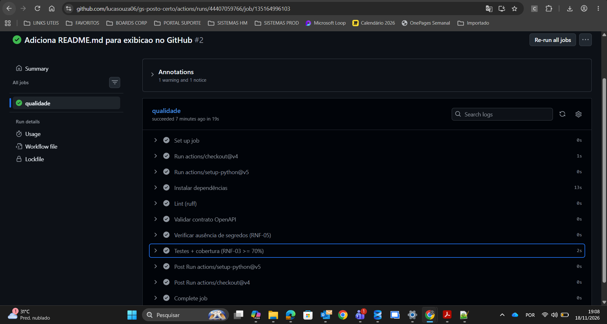

# Posto Certo — Assistente de Saúde Pública com IA

**GS2026.2 · CitizenTech · Prompt and Artificial Intelligence**
**Frente D — Serviço público essencial** · Turma 2CCPY-2026 · Modalidade: **Dupla**
Prof. Jorge Luiz Gomes

| Integrante | RM |
|---|---|
| Lucas Andrade Souza | 564066 |
| Luis Otavio Santini Feitosa | 563556 |

> **Problema:** o cidadão perde tempo e viagens indo a um posto de saúde fechado, que não oferece o serviço ou que exige documentos que ele não levou.
> **Solução:** uma API que informa postos, horários e exigências, com um assistente de IA protegido por guardrails, em que o modelo de IA pode ser trocado sem reescrever o serviço.

---

## Índice do dossiê

| # | Arquivo | Conteúdo | Critério |
|---|---------|----------|----------|
| 1 | [`1_visao_produto.md`](1_visao_produto.md) | Persona, problema, 7 RF, 6 RNF mensuráveis, 7 critérios de aceite, fora de escopo, riscos | 2 |
| 2 | [`2_contrato_api.yaml`](2_contrato_api.yaml) | OpenAPI 3.0.3: 4 endpoints, schemas, erros 400/404/422/503 | 3 |
| 3 | [`3_arquitetura.md`](3_arquitetura.md) | Diagramas, portas/adaptadores, 3 ADRs, observabilidade, segurança | 4 |
| 4 | [`4_slice/`](4_slice) | Código FastAPI + 26 testes + CI | 5 |
| 5 | [`5_evals_de_ia.md`](5_evals_de_ia.md) | 10 casos, métrica com meta, 4 guardrails, regressão, rollout | 6 |
| 6 | `6_README.md` | Este arquivo | 7 |
| 7 | `7_demo_video_url.txt` | Link do vídeo (≤ 3 min) | 1 |
| 8 | `8_certificacao.txt` | Resumo + links + nomes/RMs | 1 |
| 9 | `9_Chat_Log.txt` | Registro do uso de IA | 1 |

**Repositório:** `https://github.com/<USUARIO>/<REPOSITORIO>`

## Rastreabilidade: a mesma história em todas as peças

| Requisito | Contrato | Código | Teste | Eval |
|---|---|---|---|---|
| RF-02 / CA-02: posto inexistente | `GET /postos/{id}` → 404 `Erro` | `PostoNaoEncontrado` → handler 404 | `test_ca02_...` | — |
| RF-04 / CA-05: recusa clínica | `Resposta.motivo = FORA_DO_ESCOPO` | `guardrails.classificar()` | `test_ca05_...` | EV-05 |
| RF-05 / CA-06: emergência | `Resposta.motivo = EMERGENCIA` | `guardrails.classificar()` | `test_ca06_...` | EV-06 |
| RF-07 / CA-07: IA fora | `POST /ask` → 503 `IA_INDISPONIVEL` | `IAIndisponivel` → handler 503 | `test_ca07_...` | — |
| Risco: alucinação | `Resposta.fontes` (required) | `guardrails.fontes_citadas()` | `test_alucinacao_...` | EV-07, EV-08 |

## Como executar

### Opção A — Local (Python 3.11+)

```bash
cd 4_slice
pip install -r requirements-dev.txt
pytest --cov=src                         # 26 testes, sem LLM real
uvicorn src.api.main:app --reload        # API em http://localhost:8000/docs
```

### Opção B — GitHub Codespaces (sem instalar nada)

Abra o repositório no GitHub e clique em **Code → Codespaces → Create codespace**. As dependências são instaladas automaticamente (`.devcontainer/`). No terminal, rode os mesmos comandos da opção A.

### Validar o contrato OpenAPI

```bash
openapi-spec-validator 2_contrato_api.yaml
# saída: 2_contrato_api.yaml: OK
```

### Rodar a suíte de evals de IA

```bash
cd 4_slice
python -m evals.run_evals                       # com o fake
LLM_PROVIDER=ollama python -m evals.run_evals   # com modelo real (Ollama)
```

### Trocar o modelo de IA (1 linha de configuração)

```bash
cp 4_slice/.env.example 4_slice/.env
# LLM_PROVIDER=fake    → LLM_PROVIDER=ollama
```

## Requisições reais

```bash
curl http://localhost:8000/postos/ubs-001
# 200 {"id":"ubs-001","nome":"UBS Vila Nova","status":"ABERTO", ...}

curl http://localhost:8000/postos/ubs-999
# 404 {"codigo":"POSTO_NAO_ENCONTRADO","mensagem":"Posto ubs-999 não existe","trace_id":"..."}

curl "http://localhost:8000/postos?limit=500"
# 422 {"codigo":"VALIDACAO","detalhes":[{"campo":"limit", ...}], ...}

curl -X POST http://localhost:8000/ask -H "Content-Type: application/json" \
     -d '{"pergunta":"Onde vacino meu neto?"}'
# 200 {"resposta":"Procure a UBS Vila Nova [ubs-001]. Leve: Cartão SUS, ...",
#      "recusada":false,"motivo":"OK","fontes":["ubs-001"],"trace_id":"..."}

curl -X POST http://localhost:8000/ask -H "Content-Type: application/json" \
     -d '{"pergunta":"meu pai está com dor no peito"}'
# 200 {"resposta":"... Ligue agora para o SAMU no 192 ...","recusada":true,"motivo":"EMERGENCIA", ...}
```

## Evidências

### CI do GitHub Actions (verde)

<!-- Substituir pelo print REAL da aba Actions -->


Link da execução: `https://github.com/<USUARIO>/<REPOSITORIO>/actions/runs/<ID>`

O pipeline executa: **lint (ruff) → validação do OpenAPI → varredura de segredos → pytest com cobertura ≥ 70 %**.

### pytest local

<!-- Substituir pelo print REAL do terminal -->


## Estrutura do slice

```
4_slice/
├── src/
│   ├── domain/     # regras puras: modelos, portas, serviços, guardrails (sem lib de IA)
│   ├── infra/      # adaptadores: repositório JSON, FakeLLM, OllamaLLM, config
│   └── api/        # FastAPI: rotas, schemas espelhando o contrato, erros padronizados
├── tests/          # 26 testes — todos com FakeLLM (determinísticos)
│   ├── test_postos.py      # caminho feliz e erros (CA-01..03)
│   ├── test_ask.py         # assistente, guardrails e 503 (CA-04..07)
│   ├── test_contrato.py    # resposta real x schema do YAML (teste de contrato)
│   └── test_fronteira.py   # domínio não importa lib de LLM; troca por config
├── evals/          # suíte de qualidade da IA (roda contra o modelo real)
└── .github/workflows/ci.yml
```

## Decisões e observações

- **O contrato foi escrito antes do código.** Os schemas Pydantic em `src/api/schemas.py` espelham o YAML, e o `test_contrato.py` falha se divergirem.
- **O `ci.yml` existe em dois lugares.** O GitHub Actions só executa workflows na raiz do repositório (`/.github/workflows/`). A cópia em `4_slice/.github/workflows/ci.yml` atende à estrutura pedida no briefing. As duas são idênticas.
- **O LLM padrão é o `FakeLLM`.** O `POST /ask` funciona sem modelo instalado. Para usar um modelo real, basta `LLM_PROVIDER=ollama` (ver ADR-03).
- **Nenhuma chave no repositório.** Segredos vêm só de variáveis de ambiente, o `.env` está no `.gitignore` e o CI faz uma varredura.
- **Bônus:** teste de contrato automatizado (schema × resposta) em `tests/test_contrato.py`.
